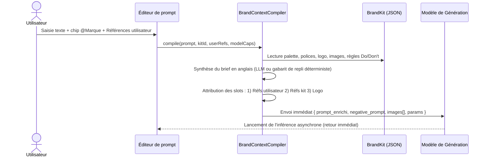

# Spécifications Fonctionnelles & Techniques — Colab AI Studio

## 1. Vision du Projet

**Colab AI Studio** est un système hybride conçu pour transformer une machine locale modeste (ex. Intel Core i5, 8 Go de RAM, pas de GPU dédié) en une station de travail IA avancée, en déportant l'ensemble des calculs lourds (inférence vidéo, image et LLM) sur le GPU distant de Google Colab via un tunnel sécurisé (**ngrok** ou **Cloudflare Tunnels**).

Le système se compose de trois éléments majeurs :
1. **Un backend local ultra-léger (FastAPI)** : Consommation mémoire minimale (< 80 Mo de RAM), servant de tour de contrôle, d'orchestrateur de tâches, de cache local de médias et de proxy API.
2. **Une interface web studio adaptative** : Une IHM moderne qui s'adapte en temps réel selon le type de modèle sélectionné (Mode Studio Vidéo/Image vs Mode Chat LLM).
3. **Un worker GPU distant (Google Colab)** : Un serveur de calcul capable de gérer l'allocation VRAM dynamique (*Model Swapper*) pour faire cohabiter modèles vidéo/image et modèles de langage au sein d'une même session GPU.

---

## 2. Architecture Globale

```
┌─────────────────────────────────────────────────────────────────────────────────┐
│                               MACHINE LOCALE (PC)                               │
│                                                                                 │
│   ┌───────────────────────────┐         ┌───────────────────────────────────┐   │
│   │     Interface Web (UI)    │ <=====> │      Backend Local (FastAPI)      │   │
│   │                           │  HTTP   │                                   │   │
│   │  • Mode Studio Vidéo/Image│   SSE   │  • Gestionnaire d'état & configs  │   │
│   │  • Mode Chat LLM          │         │  • Rapatriement auto des médias   │   │
│   │  • Sélecteur de modèles   │         │  • Proxy API OpenAI standard      │   │
│   └───────────────────────────┘         └─────────────────┬─────────────────┘   │
└───────────────────────────────────────────────────────────┼─────────────────────┘
                                                            │ Requêtes HTTP /
                                                            │ Tunnel ngrok
                                                            ▼
┌─────────────────────────────────────────────────────────────────────────────────┐
│                             INFRASTRUCTURE DISTANTE                             │
│                                                                                 │
│                       ┌───────────────────────────────┐                         │
│                       │   Relais Public ngrok / CF    │                         │
│                       └───────────────┬───────────────┘                         │
│                                       │                                         │
│                                       ▼                                         │
│                       ┌───────────────────────────────┐                         │
│                       │   Google Colab (Worker GPU)   │                         │
│                       │                               │                         │
│                       │  • Serveur FastAPI distant    │                         │
│                       │  • Gestionnaire VRAM (Swap)   │                         │
│                       │  • Pipeline Vidéo (Wan/Cog)   │                         │
│                       │  • Pipeline Image (SDXL/Flux) │                         │
│                       │  • Moteur LLM (Transformers)  │                         │
│                       └───────────────────────────────┘                         │
└─────────────────────────────────────────────────────────────────────────────────┘
```

---

## 3. Spécifications de l'Interface Utilisateur (UI/UX)

L'interface bascule dynamiquement selon la nature du modèle actif sélectionné dans la barre d'outils.

### 3.1. Mode Studio Vidéo & Image : Modularité & Conditionnement SOTA

L'interface repose sur une modularité stricte : **aucun écran ou page n'est codé en dur par modèle**. Chaque bouton ou contrôle de paramètre constitue une entité composant isolée (**un fichier par responsabilité**). Les modèles exposent un schéma déclaratif de capacités (`capabilities`) liant les paramètres disponibles.

* **Paramètres Universels ("Passe-Partout")** :
  * Automatiquement présents dans tous les groupes : invite textuelle principale, enrichissement de prompt (`🪄 On`), tirages parallèles en lot (`⚏ 1` à `4`), graine aléatoire (`seed`).
* **Deux Modes Fondamentaux de Conditionnement Vidéo & Combinaisons** :
  1. **Mode Ingrédients (*Ingredient Mode*)** : Maintien de l'identité sémantique (Dataset Bible : feuilles de personnages/turnarounds, décors/environnements, armes/props, familiers, effets visuels complexes comme cercles magiques ou auras) ou clip vidéo précédent $N-1$ (*Video-as-Ingredient* pour continuité fluide). Jusqu'à 9 références.
  2. **Mode Temporel (*Frame Chaining*)** : Cadrage spatial et interpolation via première image (`Start frame` / *First Frame*) et/ou dernière image (`End frame` / *Last Frame*).
  * **Matrice des combinaisons & Règle de subsomption** :
    * *Unitaire* : Ingrédients seuls, First Frame seul, Last Frame seul, ou First + Last (Frame Chaining complet).
    * *Partiel* : First Frame + Ingrédients, Last Frame + Ingrédients.
    * *Complet* : First Frame + Last Frame + Ingrédients.
    * *Règle de subsomption obligatoire* : Tout modèle supportant le mode complet supporte obligatoirement l'ensemble des modes partiels.
* **Gestion Modulaire de la Durée** :
  * Déclarée par le modèle selon deux typologies :
    * *Intervalle continu (`range`)* : bornes minimale et maximale avec curseur (ex. 4s à 30s).
    * *Paliers discrets fixes (`discrete`)* : sélection par pilules (ex. 5s, 10s, 15s, 20s, 25s, 30s).
* **Autres Paramètres Conditionnels** :
  * Ratio d'aspect (`16:9`, `9:16`, `1:1`, `4:3`, `21:9`), Définition (`720p`, `1080p`, `4K`), Commutateur audio/SFX natif (`🔊 On`/`Off`).
* **Suivi de Génération & Galerie** :
  * Suivi temps réel par Server-Sent Events (SSE), lecteur vidéo HTML5 avec prévisualisation et téléchargement direct.

### 3.2. Mode LLM & Passerelle API
 
Accessible directement via le 5ᵉ onglet **`[ LLM ]`** de la barre de mode du dock flottant (ou dès qu'un modèle de langage est sélectionné, ex. `Llama-3-8B`, `Mistral-7B`, `Qwen-2.5-7B`) :
 
* **Masquage complet des contrôles vidéo/image** : L'interface se reconfigure instantanément en vue de messagerie textuelle.
* **Fenêtre de Chat interactive** :
  * Historique des échanges, rendu Markdown complet, coloration syntaxique des blocs de code.
  * Streaming mot à mot des réponses (*Server-Sent Events*).
  * Contrôle des hyperparamètres (Temperature, Top-P, System Prompt).
* **Bandeau d'Information d'Endpoint API (Intégration externe)** :
  * Affichage clair de l'URL locale d'inférence :  
    `http://localhost:8000/v1/chat/completions`
  * Format 100% compatible avec l'API OpenAI.
  * Exemples d'intégration prêts à copier pour intégrer ce LLM dans Cursor, Continue.dev, scripts Python (`openai.OpenAI(base_url=...)`), ou requêtes cURL.

---

## 4. Spécifications du Backend Local (FastAPI)

Le backend est conçu pour être minimaliste, asynchrone et résistant aux coupures.

### 4.1. Responsabilités
1. **Orchestration des requêtes** : Faire l'interface entre l'application locale et l'URL du tunnel ngrok/Cloudflare du Colab distant.
2. **Surveillance de la connexion** : Ping périodique du serveur distant pour vérifier la disponibilité de la session GPU et remonter la latence et la VRAM libre.
3. **Persistance & Rapatriement automatique (Base de Données JSON)** :
   * Dès qu'une vidéo ou image est générée sur Colab, le backend local télécharge immédiatement le binaire dans le dossier de destination résolu (le répertoire dédié `storagePath` si le projet en définit un, ou le sous-dossier standard `outputs/projects/<id>/` par défaut, ou `outputs/YYYY-MM-DD/` hors projet).
   * Enregistrement systématique des métadonnées dans une **base de données orientée documents JSON** (`data/`), garantissant une sauvegarde atomique, légère et inspectable sans moteur de SGBD lourd.
   * **Gestion de la Concurrence & Verrou Asynchrone** : Pour prémunir les fichiers JSON contre toute corruption ou écrasement lors de mutations concurrentes (jusqu'à 4 tirages en parallèle, marquage de favoris via PATCH ou suppressions via DELETE), toutes les opérations de lecture-modification-écriture sont strictement sérialisées par un **verrou asynchrone applicatif (`asyncio.Lock`)** par ressource dans le backend, combiné à une écriture sur fichier temporaire et renommage atomique POSIX (`os.replace`). Aucune mise à jour n'est perdue même si une génération asynchrone se termine simultanément à une suppression.
   * Prévient toute perte de données en cas de déconnexion inopinée de Colab.
4. **Proxy API LLM** : Exposition de la route `/v1/chat/completions` (standard OpenAI) pour exploiter le GPU Colab dans des outils tiers.

### 4.2. Architecture de Stockage Local & Base de Données JSON

L'ensemble des données applicatives est conservé sous forme de fichiers JSON structurés dans le répertoire `data/` :

```
colab-ai-studio/
├── data/
│   ├── generations.json     # Journal exhaustif de toutes les créations
│   ├── brand_kits.json      # Profils de marque (logos, couleurs, polices, règles)
│   ├── projects.json        # Collections et regroupements thématiques
│   ├── config.json          # Paramètres du studio et URL du tunnel actif
│   └── assets/              # Fichiers sources importés (logos, visages, audios)
└── outputs/                 # Fichiers binaires générés (.png, .mp4, .wav)
    ├── YYYY-MM-DD/          # Partitionnement chronologique hors projet
    └── projects/<id>/       # Partitionnement par projet par défaut
```

#### 4.2.1. Schéma de `data/generations.json`
Toute génération produite est conservée avec son contexte intégral et reproductible (support natif du *Remix*) :
```json
[
  {
    "id": "gen_20261009_143022_a8f9",
    "mediaType": "video",
    "prompt": "Un plan aérien cinématique d'une forêt embrumée au lever du soleil...",
    "negativePrompt": "flou, déformé, basse résolution",
    "compiledPrompt": "A cinematic aerial drone shot of a misty forest at sunrise, sharp focus, volumetric lighting, Apple brand coherence: minimal, generous whitespace.",
    "filePath": "/home/omni/Videos/Projet_Brume/gen_20261009_143022_a8f9.mp4",
    "thumbnailPath": "/home/omni/Videos/Projet_Brume/thumbnails/gen_20261009_143022_a8f9.jpg",
    "modelId": "seedance-2.5-pro",
    "modelName": "Seedance 2.5",
    "parameters": {
      "seed": 4289102,
      "aspectRatio": "16:9",
      "resolution": "720p",
      "duration": "5s",
      "frameRate": "24 fps",
      "audio": true,
      "enhance": true
    },
    "references": {
      "startFrame": "data/assets/start_frame_01.png",
      "endFrame": null,
      "imageRefs": [],
      "videoRefs": [],
      "audioRefs": [],
      "upscaleSource": null,
      "brandKitId": "bk_apple_visuals"
    },
    "brandKitSnapshot": {
      "id": "bk_apple_visuals",
      "name": "Apple Style",
      "overview": "Esthétique minimaliste, arrière-plans neutres et éclairage studio feutré.",
      "colors": ["#000000", "#FFFFFF"],
      "logos": ["data/assets/logos/apple_white.png"],
      "fonts": ["SF Pro Display"],
      "guidelines": ["Toujours privilégier la lumière naturelle et les surfaces épurées."]
    },
    "isFavorite": true,
    "projectId": "proj_court_metrage_01",
    "createdAt": "2026-10-09T14:30:22Z"
  }
]
```

#### 4.2.2. Schéma de `data/brand_kits.json`
Stockage des chartes et identités de marque utilisées par le compilateur de prompt :
```json
[
  {
    "id": "bk_apple_visuals",
    "name": "Apple Style",
    "overview": "Esthétique minimaliste, arrière-plans neutres et éclairage studio feutré.",
    "logos": [
      { "id": "ast_logo_01", "filePath": "data/assets/logos/apple_white.png", "label": "Logo Principal" }
    ],
    "colors": [
      { "hex": "#000000", "label": "Noir Sidéral", "isDominant": true },
      { "hex": "#FFFFFF", "label": "Blanc Pur", "isDominant": false },
      { "hex": "#A2AAAD", "label": "Gris Titane", "isDominant": false }
    ],
    "fonts": [
      { "family": "SF Pro Display", "weight": "600", "filePath": null }
    ],
    "referenceImages": [
      { "id": "ast_ref_01", "filePath": "data/assets/refs/clean_product_shot.jpg" }
    ],
    "voices": [
      { "id": "voice_narrateur_01", "name": "Voix Neutre Calme" }
    ],
    "captions": [
      { "id": "cap_minimal", "style": "Sans empattement centré blanc" }
    ],
    "guidelines": [
      { "kind": "do", "text": "Toujours privilégier la lumière naturelle et les surfaces épurées." },
      { "kind": "dont", "text": "Ne jamais surcharger d'éléments graphiques ou de textures criardes." }
    ],
    "createdAt": "2026-10-09T12:00:00Z",
    "updatedAt": "2026-10-09T14:15:00Z",
    "lastUsedAt": "2026-10-09T14:30:00Z"
  }
]
```

#### 4.2.3. Schéma de `data/projects.json`
Organisation en collections et dossiers avec stratégie de stockage physique dédiée :
```json
[
  {
    "id": "proj_court_metrage_01",
    "name": "Court-métrage Brume",
    "description": "Scènes de cinématique en extérieur",
    "colorTag": "#3B82F6",
    "storagePath": "/home/omni/Videos/Projet_Brume",
    "createdAt": "2026-10-09T10:00:00Z"
  }
]
```
* **Stratégie de Rapatriement et d'Isolation de Stockage** :
  * Si `storagePath` est `null` ou non renseigné : les créations associées au projet sont enregistrées dans le sous-dossier standard de l'application (`outputs/projects/<id>/`).
  * Si `storagePath` est explicitement spécifié lors de la création du projet : **l'intégralité des générations, miniatures et fichiers binaires liés à ce projet est stockée exclusivement et directement dans ce répertoire physique sur mesure**, sans aucune duplication dans le dossier par défaut `outputs/`.

#### 4.2.4. Schéma de `data/config.json`
Configuration générale de l'environnement, du mode d'exécution et des liaisons :
```json
{
  "executionMode": "colab",
  "colab": {
    "tunnelUrl": "https://xxxx-xx-xx.ngrok-free.app",
    "accountEmail": "user@gmail.com",
    "lastPing": "2026-10-10T00:15:00Z"
  },
  "local": {
    "device": "cpu",
    "threads": 4
  },
  "compilerLlm": {
    "provider": "gemini",
    "model": "gemini-1.5-flash",
    "apiKeyEnv": "COMPILER_LLM_API_KEY",
    "apiKey": null
  },
  "defaultStoragePath": "outputs/",
  "llmProxy": {
    "enabled": true,
    "port": 8000
  }
}
```
* **Règle du Mode d'Exécution (`executionMode`) & Parcours Local** :
  * Valeurs possibles : `"colab"` (déportation des inférences sur Google Colab via tunnel) ou `"local"` (inférence sur les ressources de la machine hôte).
  * **Comportement actif (MVP / Phase 1 & 2)** : Le studio fonctionne activement par défaut via son worker déporté Google Colab (`"colab"`). L'ensemble des routes (`/api/models`, `/api/models/switch`, `/api/generate/media`) s'adressent au worker Colab.
  * **Réservation du Mode Local** : Le runner local sur machine hôte fait l'objet d'un chantier dédié (suivi dans l'issue [#2](https://github.com/personnal-agent/colab-ai-studio/issues/2)). Si `executionMode: "local"` est forcé dans `config.json` avant l'implémentation complète de ce runner, l'indicateur d'avatar reste grisé inerte (`#9CA3AF`) et les routes d'inférence renvoient un statut HTTP explicite `501 Not Implemented` (`{"detail": "Runner local en cours de développement (voir Issue #2)"}`), évitant toute promesse d'exécution locale non implémentée.

### 4.3. Endpoints Locaux Principaux
* `GET /api/health` : État du backend et diagnostic de liaison Colab (latence, VRAM disponible).
* `POST /api/config/colab-url` : Mise à jour de l'URL publique ngrok/Cloudflare active.
* `GET /api/models` : Liste dynamique des modèles disponibles sur le worker Colab.
* `POST /api/models/switch` : Ordre de changement de modèle envoyé à Colab (déclenche l'éviction VRAM).
* `POST /api/generate/media` : Lancement asynchrone d'une tâche de génération.
* `GET /api/tasks/{task_id}/status` : Flux SSE de progression temps réel de l'inférence.
* `POST /api/tasks/{task_id}/cancel` : Demande d'annulation idempotente d'une tâche de génération en cours.
* `GET /api/generations` : Liste des créations locales (avec filtres : favoris, type, projet, recherche).
* `PATCH /api/generations/{id}/favorite` : Bascule de l'état favori d'un média.
* `DELETE /api/generations/{id}` : Suppression d'une création (métadonnées et fichier sur disque).
* `GET /api/brand-kits` : Récupération des Brand Kits enregistrés.
* `POST /api/brand-kits` : Création ou mise à jour d'un Brand Kit.
* `GET /api/projects` : Liste des collections et projets.
* `POST /api/projects` : Création d'une nouvelle collection.
* `POST /v1/chat/completions` : Endpoint d'API LLM compatible OpenAI.

### 4.4. Compilateur de Contexte de Marque (*BrandContextCompiler*)

Le compilateur assure la transposition des éléments d'un Brand Kit actif vers la requête transmise au modèle de génération, en s'adaptant strictement au schéma d'entrée et aux contraintes du modèle :



1. **Composition du Brief par LLM & Repli Déterministe (*Graceful Fallback*)** :
   - Le compilateur s'appuie sur la configuration `compilerLlm` de `data/config.json` (ou la variable d'environnement `COMPILER_LLM_API_KEY`).
   - Lorsqu'une clé API valide est présente, le LLM reformule l'Overview, les couleurs (noms et codes hexadécimaux), les directives Do/Don't et les polices dans un brief cinématique/photographique fluide, **rédigé en anglais** pour le modèle récepteur. Les interdictions ("Don't") sont orientées vers le `negative_prompt`.
   - **Politique de Repli Déterministe (Sans IA)** : Si aucune clé API n'est configurée, si la clé est invalide ou révoquée, en cas d'erreur serveur du fournisseur (HTTP 5xx), de quota dépassé ou de timeout réseau, le compilateur bascule immédiatement et de façon transparente sur un **gabarit déterministe pré-formaté en anglais** :  
     - *Prompt enrichi* : `"[Brand Identity: {name}] Style: {overview_en}. Palette: {hex_colors}. Typography: {fonts}. Guidelines: {dos_en}."`  
     - *Negative Prompt* : `"{donts_en}, brand inconsistency, distorted logo, unapproved color palette"`  
     - *Exigence linguistique* : Les champs `overview` et `guidelines` du kit sont traduits ou stockés en anglais (avec fallback automatique direct sur les libellés sources) afin de garantir la cohérence d'inférence des modèles anglophones.  
     Ce mécanisme garantit qu'aucune défaillance de clé ou d'API LLM ne bloque la génération de l'utilisateur.
2. **Priorité d'Attribution des Fentes d'Images de Référence** :
   - Lorsque le modèle impose un quota d'images de référence :
     - **Priorité 1** : Références manuelles déposées par l'utilisateur (sanctuarisées, jamais écrasées).
     - **Priorité 2** : Images de référence du kit (dans la limite des slots restants).
     - **Priorité 3** : Logo de la marque (dans la limite des slots restants).
   - **Dépassement de quota utilisateur (`userRefs`)** : Si l'utilisateur dépose plus de références que la capacité admise par le modèle (`modelCaps.maxImageRefs`), le compilateur retient en priorité les $N$ premières références manuelles dans l'ordre de dépôt (avec avertissement visuel préalable dans l'interface), garantissant que les références utilisateur ne sont jamais tronquées au profit des actifs du kit.
3. **Injection du Logo de Marque** :
   - Le logo est injecté dès qu'un slot de référence est disponible, accompagné dans le prompt de la consigne explicite en anglais :  
     *"Here is the brand logo, make sure your generation remains coherent with this brand identity."*
4. **Repli sur les Modèles Sans Référence Visuelle (Texte Seul)** :
   - Si le modèle sélectionné ne prend aucune image de référence (ex. Kling texte seul, Recraft V4.1), le compilateur bascule automatiquement et de façon transparente sur l'envoi du brief textuel uniquement, sans bloquer l'utilisateur.
5. **Déclenchement Direct Sans Panneau Intermédiaire** :
   - Aucun écran de validation intermédiaire : la compilation et l'envoi vers le worker Colab s'effectuent immédiatement au clic sur `↑`.
6. **Épure de l'Interface** :
   - L'IHM ne présente aucun indicateur technique superflu concernant l'approximation des codes hexadécimaux ou des polices sur les modèles non-dédiés.

---

## 5. Spécifications du Worker Distant (Google Colab)

### 5.1. Gestion Dynamique de la VRAM (*Model Swapper*)
Comme le GPU Colab gratuit (Nvidia T4 - 15-16 Go VRAM) ne peut pas héberger simultanément un modèle vidéo et un LLM :
* **Protocole d'éviction mémoire** :
  ```python
  def unload_current_model():
      global active_model, active_pipeline
      if active_pipeline is not None:
          del active_pipeline
          active_pipeline = None
      if active_model is not None:
          del active_model
          active_model = None
      gc.collect()
      torch.cuda.empty_cache()
      torch.cuda.ipc_collect()
  ```
* **Chargement à la demande** :
  * Le worker charge uniquement les poids nécessaires pour la tâche courante.
  * Notification de progression du chargement vers le backend local.

### 5.2. Asynchronisme & Prévention des Timeouts
* La génération de vidéos pouvant nécessiter plusieurs minutes, l'exécution s'effectue dans un thread d'arrière-plan avec génération d'un identifiant de tâche (`task_id`).
* Des callbacks de progression (étape $N$ sur $Total$) mettent à jour l'état de la tâche, consultable à tout moment par l'orchestrateur local via flux SSE.
* **Protocole d'annulation** : Le worker observe la demande d'annulation (`POST /api/tasks/{task_id}/cancel`), interrompt immédiatement la boucle d'inférence en cours et publie un état terminal `cancelled`.

---

## 6. Plan d'Implémentation & Jalons

* **Phase 1 : Socle & Spécifications (Actif)**
  * Architecture, README, spécifications exhaustives UI/UX et système, persistance documentaire JSON, publication GitHub.
* **Phase 2 : Backend Local & Persistance Documentaire JSON**
  * Serveur FastAPI local avec persistance atomique documentaire dans `data/` (`generations.json`, `projects.json`, `brand_kits.json`, `config.json`).
  * Orchestrateur de tâches asynchrones avec verrou de concurrence `asyncio.Lock` et flux SSE.
* **Phase 3 : Application Monopage React (SPA)**
  * Interface React (Vite, Tailwind CSS v3, Radix UI) avec poste de commande unifié (*Floating Prompt Dock*).
  * Sélecteur de modèles dynamique et gestionnaire de projets avec arborescence physique.
* **Phase 4 : Worker Colab & Gestionnaire VRAM**
  * Notebook Colab optimisé T4 avec Model Swapper dynamique et tunnel public chiffré.
* **Phase 5 : Intégration de Bout en Bout & Tests**
  * Validation du cycle complet de génération, rapatriement local et streaming LLM.
